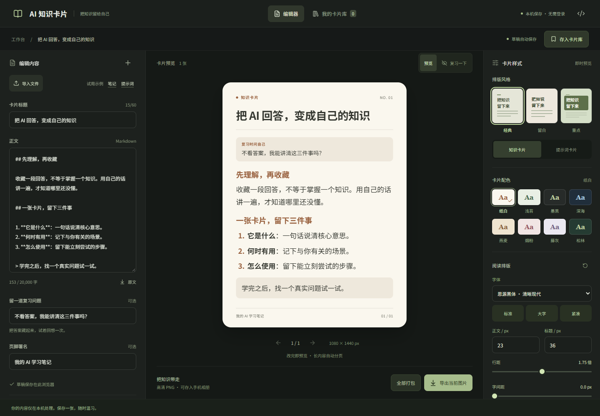

# AI 知识卡片

把 AI 回答、学习笔记和常用提示词，整理成方便保存、复习与分享的中文卡片。

这是 Allensen 的独立开源项目。面向所有想把有用内容留下来的人，暂用「AI 知识卡片」作为工作名。无需模型 API 密钥，无需登录，编辑和图片导出在浏览器中完成。

- **在线工具**：https://Allensen.github.io/ai-note-cards/
- **源码仓库**：https://github.com/Allensen/ai-note-cards
- **反馈与功能建议**：https://github.com/Allensen/ai-note-cards/issues

在线工具用于直接制作卡片；源码仓库用于下载、修改、查看版本和反馈。



## 基础版有什么

- 粘贴文本或导入 UTF-8 `.txt` / `.md` / `.markdown`。
- 中文标题、正文、署名，Markdown 实时排版。
- 纸白、浅苔、墨黑三个主题；3:4 竖版、1:1 方形；三个字号。
- 根据实际字体和可用高度自动分页；独立一行 `---` 可手动分页。
- 导出当前 PNG（1080 × 1440 / 1080 × 1080），或将全部卡片打包为 ZIP。
- 自动保存当前浏览器的草稿，保存 Markdown 原文，新建和替换示例可撤销。
- 桌面双栏工作台；手机编辑 / 预览切换。

## 本次新增：提示词卡片版式

在「版式」中选择「提示词卡片」，`## 适用场景` 下的内容会显示为独立说明区，`## 提示词正文` 以下为提示词主体。点「提示词示例」可以加载演示内容，再切换两种版式对比。切换只改变排版，不会改写原文。没有这些小标题的内容仍正常呈现。

它沿用基础版的主题、分页、字体嵌入和导出。基础版已经可以收藏提示词文本；本次新增的是专用版式和两类内容的视觉区分。

## 本地运行

建议 Node.js 22 LTS 或更新版本（本地也在 Node 20.20.2 验证）。

```sh
npm ci
npm run dev -- --port 4173
```

浏览器打开 http://127.0.0.1:4173/ 。代码修改后自动更新。

```sh
npm run build
npm run preview -- --port 4174
```

`dist/` 是可部署到静态托管的网页文件。请通过 HTTP 服务访问，不要直接双击 `index.html`。

## 怎么用

1. 在正文粘贴内容，或者点「导入文件」。导入首行 `# 标题` 会填入卡片标题。
2. 调整标题、主题、画布、字号和署名。
3. 翻页查看完整内容。长文自动分页，不会静默裁掉末尾。
4. 点「导出当前图片」保存 PNG；多页可以「全部打包」。如果浏览器没开始下载，可以点「重新下载」。

```markdown
## 今天学到的概念

用自己的话解释它，**标出最重要的一句**。

1. 什么时候用
2. 怎么尝试

> 给未来的自己留一个问题。
```

正文最多 20,000 字、最多 60 张卡片；文件大小最多 250 KB。复杂宽表格不适合卡片，建议拆为短段落。超长段落可能在句中换页；长列表项继续到下一页时会保留原序号。Markdown 图片显示说明文字，不加载图片；HTML 样式、嵌入、脚本和交互链接不执行。不支持数学公式渲染。

## 中文字体与隐私

Noto Sans SC 字体随站点托管。首次打开时浏览器会加载需要的字体分片；排版等待字体就绪，导出把相关分片嵌入图片生成过程。预览和导出使用同一套卡片 DOM 与样式。

没有服务端、模型 API 或统计 SDK。正文不上传，外链图片不自动请求。草稿仅存于本站的 `localStorage`，不是云备份；新建笔记会替换旧草稿，关闭页面后撤销历史不保留。请下载原文备份重要内容。托管平台仍会收到普通网页与字体资源请求。

## 修改与贡献

| 想改什么 | 文件 |
| --- | --- |
| 界面、操作流程 | `src/App.tsx` |
| 工作台颜色、移动布局 | `src/App.module.css` |
| 卡片版式、主题、字体大小 | `src/Card.tsx`、`src/Card.module.css` |
| 示例文本与草稿格式 | `src/model.ts` |
| Markdown 清理、分页逻辑 | `src/markdown.ts` |
| 字体加载与导出嵌入 | `src/fonts.ts` |

可以把具体需求交给 Codex、Claude Code 或其他 Agent，例如：「请在保留现有主题与导出的前提下，添加适合提示词的卡片版式，并运行分页与导出测试。」

欢迎先在 Issues 描述使用场景，再通过 Fork + Pull Request 贡献。提交前运行构建和相关测试；不要提交真实私人笔记、密钥、`node_modules`、`dist` 或录屏素材。

## 验证

```sh
# 本机已安装 Chrome
npm test

# CI / 没有本机 Chrome 时
npx playwright install chromium
# 设置 CI=1 后运行 npm test
```

自动化覆盖中文导出尺寸、草稿恢复、主题切换、长中文完整性、列表/代码/表格分页、ZIP 页数、导入/撤销/空内容/超限、恶意 Markdown、375px 移动端。测试产物位于被忽略的 `test-results/`。

`tests/demo.spec.ts` 和 `tests/demo-mobile.spec.ts` 提供可复现的浏览器演示录制；默认跳过。设置环境变量 `RECORD_DEMO=1` 后运行 `npx playwright test demo`，会录制 1920×1080 横屏和 540×960 竖屏的真实浏览器操作，原始 WebM 位于 `test-results/`。这是自动化操作实录，不是桌面或 Agent 对话录屏。

目前主要验证 Chromium。Safari、Firefox 和真机 iOS 的字体、内存与下载行为仍需更多验证；手机长文建议逐张导出。

## 版本与许可

基础演示版使用标签 `demo-v0.1-base`；新增提示词版式使用 `demo-v0.2-prompt`。两份版本来自真实开发提交。

为了安全地对照旧版，建议在另一个目录运行：

```sh
git worktree add ../ai-note-cards-base demo-v0.1-base
cd ../ai-note-cards-base
npm ci
npm run dev -- --port 4175
```

或用 `git diff demo-v0.1-base demo-v0.2-prompt -- src` 查看实际改动。不要在有未保存修改的工作区使用强制重置。

原创代码采用 [MIT](LICENSE)。依赖和字体保留各自许可证，见 [THIRD_PARTY_NOTICES.md](THIRD_PARTY_NOTICES.md) 与 `public/licenses/`。
